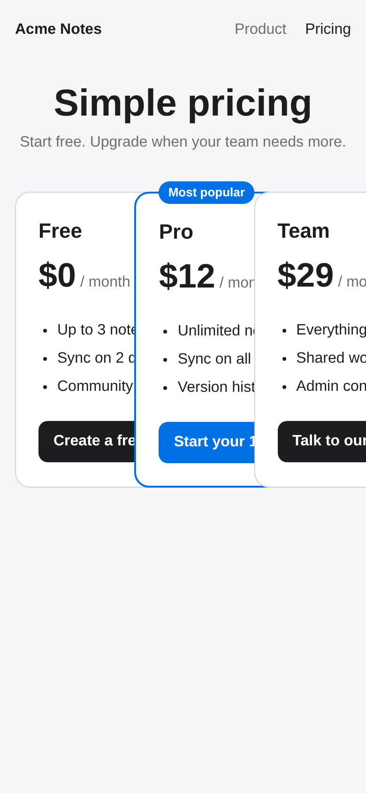

# Devin demo: Fix a UI bug from a screenshot

**What it shows:** You give Devin a screenshot of a broken pricing page. Devin opens the page in its own browser, finds the CSS that causes the bug, fixes it, and opens a pull request with before and after screenshots.

**Needs:** GitHub only

More demos: [devin-advanced-demos](https://github.com/thequantexplorer/devin-advanced-demos)

## The bug



On a phone, the three pricing cards sit on top of each other, the page scrolls sideways, and the button labels are cut off. On a laptop the page looks fine. The tests in `tests/layout.spec.js` check for exactly this, and 7 of the 12 checks fail today.

## Set it up

1. Click **Use this template → Create a new repository**, choose your GitHub account or org as the owner, and keep the name `devin-demo-ui-bug-from-screenshot`. The links and prompt below assume that name. Use the template rather than a fork: pull requests on a fork go to the original repo by default.
2. In Devin, open [**Settings → Connections → GitHub**](https://app.devin.ai/settings/connections/github) and make sure Devin can access the new repository.
3. Open `docs/bug.png` in your copy on GitHub. This is the screenshot Devin will work from.

## Prompt

Start a new Devin session at [app.devin.ai](https://app.devin.ai) and paste this. Replace `<you>` with your GitHub user or org.

```text
Our pricing page looks broken on phones. Repo: https://github.com/<you>/devin-demo-ui-bug-from-screenshot

A user sent the screenshot in docs/bug.png. Open it and look at it first: the pricing cards overlap and the button text is cut off. It looks fine on a laptop.

Run the page and reproduce the bug in your browser at 390px wide. Find the CSS that causes it and fix it in public/styles.css. Keep three cards side by side on wide screens. Do not change the tests.

Run npm test and make sure every check passes. Take a screenshot of the page at 390px wide before your fix and after it (npm run screenshot can do this). Open a PR that shows both screenshots in the description and explains the cause in two or three sentences.
```

## What to watch

- Devin opens `docs/bug.png` and describes what it sees before it changes any code.
- It finds the real cause in the CSS instead of hiding the symptoms.

## You're done when

- The PR description shows a before screenshot and an after screenshot.
- The **Layout tests** check on the PR is green.
